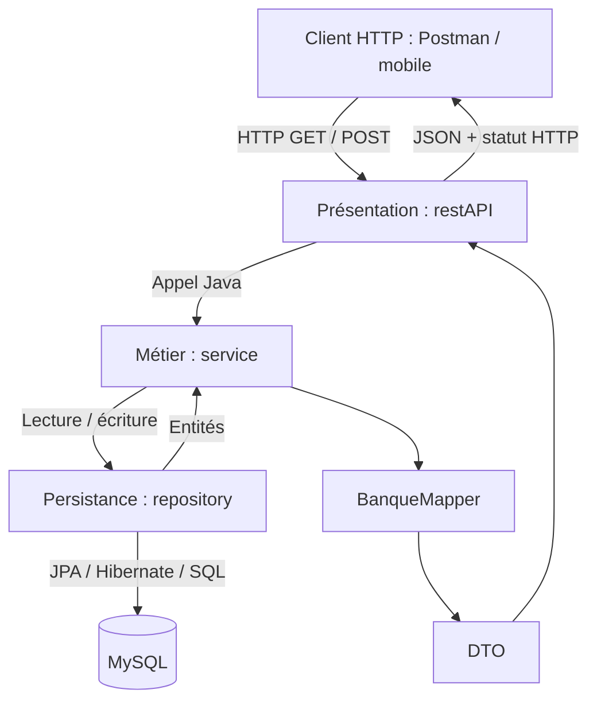
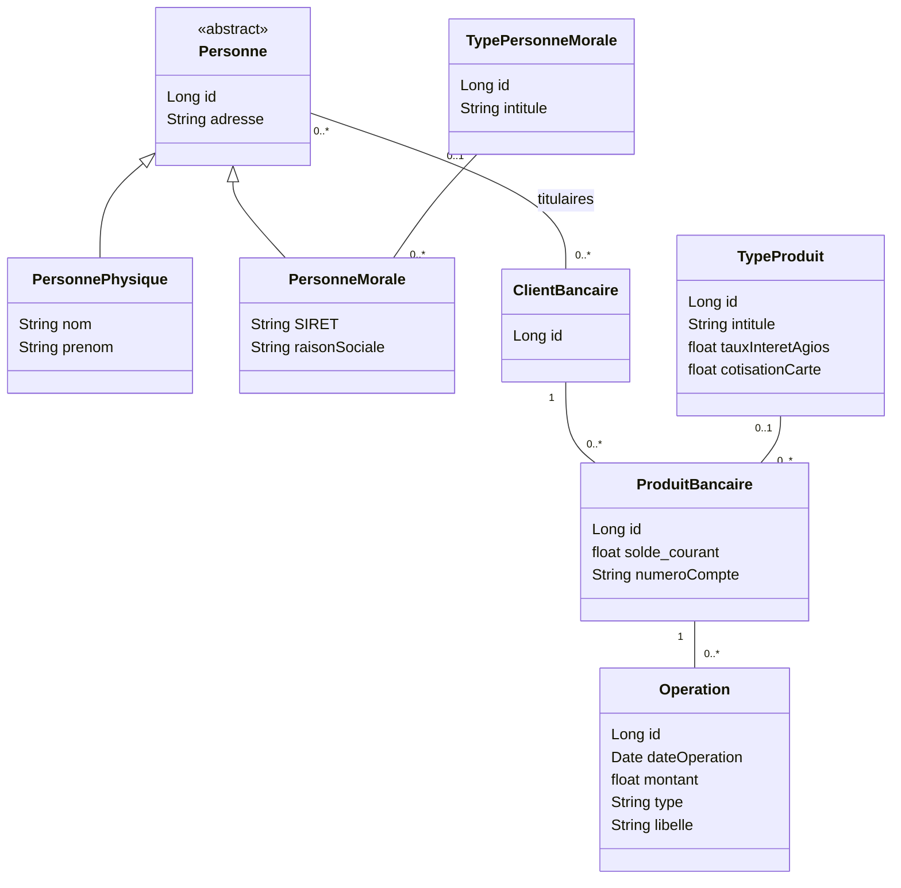
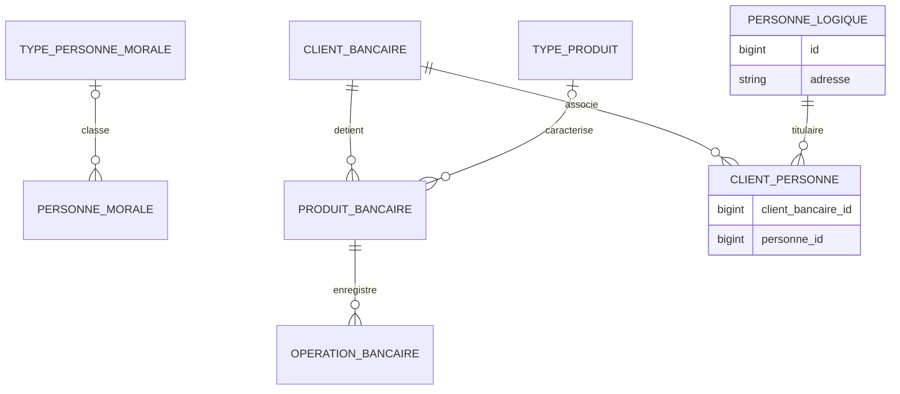
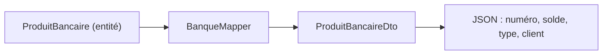
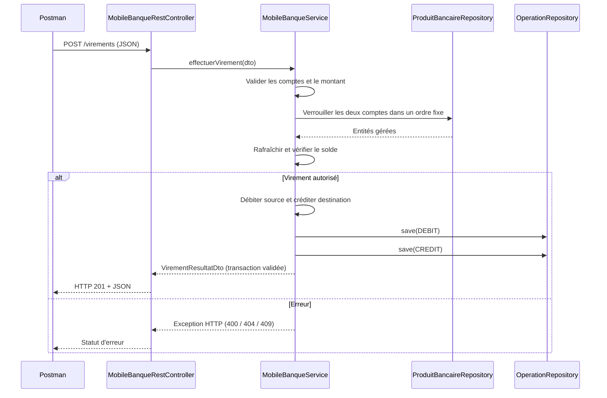

# Architecture en couches — Documentation pédagogique

Projet Banque · Master MIAGE · Référence du code : commit [eb92919](https://github.com/Koloina-Rakotomavo/archi_en_couches/commit/eb92919a3eddd53c1a6a897021a56f3cf2727958) (15, virement bancaire). Cette documentation explique le code effectivement construit, et non une architecture bancaire de production. Pour installer les logiciels et lancer le projet : [README](../README.md).

## Sommaire

1. [Comprendre l'architecture](#1-comprendre-larchitecture-en-couches)
2. [Structure du projet](#2-structure-du-projet)
3. [Modèle de données](#3-modèle-de-données)
4. [Construire la persistance](#4-construire-la-persistance)
5. [Services métier](#5-services-métier)
6. [DTO et mappers](#6-dto-et-mappers)
7. [API REST et tests Postman](#7-api-rest-et-tests-postman)
8. [Virement bancaire](#8-virement-bancaire-transactionnel)
9. [Tests et limites](#9-tests-et-limites)
10. [Historique des commits](#10-historique-des-commits)

## 1. Comprendre l'architecture en couches

Imaginez un client bancaire qui veut connaître son solde. Postman ou une application mobile ne doit pas interroger directement MySQL. La requête passe par plusieurs couches, chacune ayant un travail précis.



| Couche | Question à laquelle elle répond | Exemple réel |
|---|---|---|
| Modèle | Quelles données et quelles relations existent ? | ProduitBancaire, Operation |
| Repository | Comment retrouver ou enregistrer les données ? | ProduitBancaireRepository |
| Service | Quelles actions métier sont autorisées ? | MobileBanqueService |
| Contrôleur REST | Comment rendre ces actions accessibles par HTTP ? | MobileBanqueRestController |
| DTO | Quelles données transmettre au client ? | ProduitBancaireDto |
| Mapper | Comment transformer les entités en DTO ? | BanqueMapper |

Les dépendances vont essentiellement du contrôleur au service, du service au repository et du repository au modèle. Le DTO n'est pas une table SQL. Le mapper ne doit pas rechercher lui-même des objets en base.

**Pourquoi séparer ?** Pour respecter la responsabilité unique (SRP), réduire le couplage, tester les règles indépendamment de HTTP, changer le contrat JSON sans modifier les tables et éviter que les relations JPA ne soient toutes sérialisées.

### Exemple concret

`GET /banque_rest/mobile/produits/MOBILE001`

1. Le contrôleur reçoit MOBILE001 grâce à @PathVariable.
2. Le service recherche un produit dont le numéro correspond et dont le type est « compte chèque ».
3. Le repository construit la requête via Spring Data JPA.
4. Hibernate exécute les opérations SQL et reconstitue les objets Java.
5. Le service appelle BanqueMapper.toDtoSansOperations.
6. Spring MVC sérialise le DTO en JSON et renvoie HTTP 200 ; si le compte chèque est absent, le service déclenche HTTP 404.

## 2. Structure du projet

```text
archi_en_couches/
├── pom.xml
├── mvnw / mvnw.cmd
├── README.md
├── docs/
│   └── ARCHITECTURE.md
└── src/
    ├── main/
    │   ├── java/com/example/banque/
    │   │   ├── BanqueApplication.java
    │   │   ├── model/                # Entités JPA
    │   │   ├── repository/           # Interfaces Spring Data
    │   │   ├── service/              # Contrats CRUD + service mobile
    │   │   │   └── impl/             # Implémentations CRUD
    │   │   ├── restAPI/              # Contrôleurs HTTP
    │   │   ├── dataTransferObjects/  # Contrats de données
    │   │   └── mapper/               # Conversions
    │   └── resources/
    │       └── application.properties
    └── test/java/com/example/banque/
        ├── mapper/BanqueMapperTest.java
        └── service/MobileBanqueServiceTest.java
```

Arbre simplifié, pas inventaire exhaustif. Le package réel est **com.example.banque** : les imports d'un énoncé utilisant com.banque doivent être adaptés.

Le POM déclare Java 21, Spring Boot 4.1.1, Data JPA, Web MVC, Thymeleaf, MySQL Connector/J, DevTools et les dépendances de test. Spring Boot démarre depuis BanqueApplication.main ; @SpringBootApplication active notamment la configuration automatique et la détection des composants du package.

## 3. Modèle de données

### 3.1 Diagramme de classes métier

Les cardinalités ci-dessous décrivent les associations du code, pas toutes les contraintes d'une banque réelle. Par exemple, la liste des titulaires peut être vide et certains types sont facultatifs dans le mapping.



### 3.2 Dictionnaire des données

| Entité | Attributs scalaires | Rôle |
|---|---|---|
| Personne (abstraite) | id : Long ; adresse : String | Informations communes aux personnes |
| PersonnePhysique | nom : String non nul ; prenom : String facultatif ; attributs hérités | Particulier |
| PersonneMorale | SIRET : String facultatif ; raisonSociale : String non nulle ; attributs hérités | Organisation |
| TypePersonneMorale | id : Long ; intitule : String non nul | Catégorie : société, association, etc. |
| ClientBancaire | id : Long | Regroupe les titulaires et leurs produits |
| ProduitBancaire | id : Long ; solde_courant : float non nul ; numeroCompte : String non nul | Produit souscrit par un client |
| TypeProduit | id : Long ; intitule : String non nul ; tauxInteretAgios : float ; cotisationCarte : float | Catalogue et paramètres des produits |
| Operation | id : Long ; dateOperation : Date non nulle ; montant : float non nul ; type : String non nul ; libelle : String | Mouvement attaché à un produit |

Les identifiants sont générés avec @SequenceGenerator et @GeneratedValue(SEQUENCE). Le mapping peut créer des tables auxiliaires de séquence selon le dialecte MySQL. Les champs float primitifs ne peuvent pas être null en Java, même lorsque l'annotation de colonne permet null. Aucun caractère unique sur numeroCompte n'est déclaré dans le modèle lu.

### 3.3 Modèle relationnel logique

Avec l'héritage TABLE_PER_CLASS, les attributs hérités sont présents dans les tables concrètes des personnes. Personne est abstraite : ne pas supposer l'existence d'une table personne physique au sens SQL sans examiner le schéma réellement généré.



PERSONNE_LOGIQUE est une représentation conceptuelle du parent polymorphe, pas le nom d'une table garantie. Le nom client_personne est explicitement déclaré dans @JoinTable. PersonnePhysique et PersonneMorale déclarent respectivement personne_physique et personne_morale. Operation déclare operation_bancaire. Les autres noms physiques implicites dépendent de la stratégie de nommage Hibernate.

| Association | Mapping propriétaire | Clé / table |
|---|---|---|
| Personne – ClientBancaire | ClientBancaire.personnes, @ManyToMany | client_personne (client_bancaire_id, personne_id) |
| TypePersonneMorale – PersonneMorale | PersonneMorale.typePersonneMorale, @ManyToOne | type_personne_morale_id |
| TypeProduit – ProduitBancaire | ProduitBancaire.typeProduit, @ManyToOne | type_produit_id |
| ClientBancaire – ProduitBancaire | ProduitBancaire.clientBancaire, @ManyToOne obligatoire | client_bancaire_id |
| ProduitBancaire – Operation | Operation.produitBancaire, @ManyToOne obligatoire | produit_bancaire_id |

Une personne peut être titulaire de plusieurs clients bancaires ; un client bancaire peut avoir plusieurs personnes (ex. compte joint). Un produit appartient à un seul client bancaire et une opération à un seul produit.

### 3.4 JPA : annotations et règles de suppression

- @Entity : classe persistante ; @Id : clé primaire ; @Column : mapping de colonne.
- @OneToMany / @ManyToOne : association 1-N. mappedBy désigne l'attribut propriétaire de l'autre côté, et non le nom de la colonne SQL.
- @ManyToMany : association N-N via table intermédiaire.
- @Inheritance(TABLE_PER_CLASS) : stratégie d'héritage utilisée pour Personne.
- FetchType.EAGER : chargement immédiat demandé ; attention aux graphes volumineux. LAZY charge à la demande selon le contexte JPA.
- cascade : propage certaines opérations JPA ; orphanRemoval supprime un enfant retiré de son association selon le mapping.
- @PreRemove : méthode appelée avant suppression pour gérer les relations. Les méthodes add/remove synchronisent les associations bidirectionnelles.

Dans le code, ClientBancaire refuse sa suppression si des produits lui restent rattachés. TypeProduit.produitsBancaires et ProduitBancaire.operations utilisent cascade ALL et orphanRemoval : leur suppression peut entraîner celle des enfants. La relation personnes/clients utilise également cascade ALL ; ce choix mérite une vérification d'intégration avant toute suppression réelle. Ne pas confondre le nettoyage des liens avec la garantie d'absence de suppression en cascade.

Pour examiner le schéma effectif après lancement dans une base jetable :

```sql
USE banque;
SHOW TABLES;
SHOW CREATE TABLE client_personne;
SHOW CREATE TABLE operation_bancaire;
```

## 4. Construire la persistance

### Étape 1 — Entité puis repository

Créer le package model, une classe avec @Entity, un identifiant et les attributs métier. Ensuite, créer le package repository et une interface qui étend JpaRepository.

```java
public interface ProduitBancaireRepository
        extends JpaRepository<ProduitBancaire, Long> {
    // Requêtes supplémentaires dans le code du projet.
}
```

JpaRepository fournit save, saveAll, findAll, findById, count, existsById, deleteById, tri et pagination. Spring génère l'implémentation à l'exécution. Long correspond au type de la clé primaire.

### Étape 2 — Requêtes dérivées

Dans TypeProduitRepository et le runner, les recherches illustrent findByIntitule, findByIntituleContains, findByIntituleLike, findFirst3ByOrderByIdDesc et findByTauxInteretAgiosGreaterThanEqualOrderByTauxInteretAgiosAsc.

Exemple réel mobile :

```java
List<Operation> findTop5ByProduitBancaire_IdOrderByDateOperationDescIdDesc(
        Long produitId);
```

Cela limite aux cinq opérations du produit indiqué et trie par date décroissante, puis identifiant décroissant pour départager les dates identiques. Le service n'a donc pas à charger toute la liste pour la tronquer.

### Étape 3 — Tester progressivement

BanqueApplication contient un CommandLineRunner qui crée les types de produits, teste les recherches, le tri et la pagination, crée les personnes et leurs associations, puis enregistre les opérations. MobileDemoData crée aussi deux comptes de démonstration.

Le runner efface les types de produits au démarrage et Hibernate utilise create-drop. C'est une stratégie de TD, pas une initialisation de production. Ne jamais pointer sur des données réelles.

## 5. Services métier

### 5.1 Interface et implémentation

Au commit 8, TypeProduitService sépare le contrat de son implémentation. Les méthodes du contrat sont getAllTypeProduit, createTypeProduit, getTypeProduitById, updateTypeProduit et deleteTypeProduitById.

Extrait de TypeProduitServiceImpl :

```java
@Service
public class TypeProduitServiceImpl implements TypeProduitService {
    private TypeProduitRepository typeProduitRepository;

    @Autowired
    public TypeProduitServiceImpl(TypeProduitRepository typeProduitRepository) {
        this.typeProduitRepository = typeProduitRepository;
    }

    @Override
    public List<TypeProduit> getAllTypeProduit() {
        return typeProduitRepository.findAll();
    }
    // Autres méthodes dans le dépôt.
}
```

@Service permet à Spring de gérer l'objet ; l'injection par constructeur fournit le repository automatiquement. On ne crée pas le repository avec new. Le service utilise save pour créer et mettre à jour, findById(...).orElseThrow() pour obtenir un objet, et deleteById pour le supprimer.

Les autres services ajoutés au commit 9 concernent PersonnePhysique, PersonneMorale, TypePersonneMorale, ClientBancaire, ProduitBancaire et Operation, avec leurs implémentations dans service.impl.

MobileBanqueService est quant à lui une classe @Service directement injectée, sans interface distincte dans le code actuel. Il contient les cas d'usage de consultation et de virement.

### 5.2 Contrôleur REST

@RestController indique que les résultats sont écrits dans la réponse HTTP. @RequestMapping donne le préfixe de route, @GetMapping lit, @PostMapping crée, @PutMapping met à jour, @DeleteMapping supprime. @RequestBody désérialise le JSON et @PathVariable récupère une valeur dans l'URL. ResponseEntity permet de préciser le statut HTTP.

Exemple TypeProduit :

```java
@PostMapping("/add")
public ResponseEntity<TypeProduit> addTypeProduit(@RequestBody TypeProduit typeProduit) {
    TypeProduit tp = typeProduitService.createTypeProduit(typeProduit);
    return new ResponseEntity<>(tp, HttpStatus.CREATED);
}
```

Ce contrôleur administratif renvoie toujours des entités dans le code actuel. Les DTO sont réellement utilisés par l'API mobile : la migration de l'ancien contrôleur vers les DTO n'est pas encore réalisée.

## 6. DTO et mappers

Une entité peut contenir des relations inverses, des identifiants techniques ou des informations inutiles au client. La sérialiser directement peut créer un graphe JSON trop profond ou circulaire. Le DTO est un objet de transport : pas de @Entity ni de persistance autonome.

| DTO | Champs effectivement déclarés |
|---|---|
| TypeProduitDto | cotisationCarte, tauxInteretAgios, intitule |
| PersonneDto | nom, adresse, typePersonne (PHYSIQUE/MORALE) |
| ClientBancaireDto | personneDtos (Set) |
| ProduitBancaireDto | numeroCompte, soldeCourant, typeProduitDto, clientBancaireDto, operationDtos (Set) |
| OperationDto | intituleOperation, montant, dateOperation, typeOperation, produitBancaireId |
| VirementDto | compteSource, compteDestination, montant (BigDecimal) |
| VirementResultatDto | record retournant les numéros, montant et soldes après virement |

BanqueMapper est une classe utilitaire finale, avec des méthodes statiques. Il transforme les entités sans exposer les associations inverses.

```java
public static TypeProduitDto toDto(TypeProduit type) {
    if (type == null) return null;
    return new TypeProduitDto(type.getTauxInteretAgios(), type.getIntitule(),
            type.getCotisationCarte());
}
```

- Une personne physique transmet son nom, une personne morale sa raison sociale ; ni prénom ni SIRET ne sont transportés dans ce DTO.
- toDtoSansOperations construit un DTO de compte avec un ensemble d'opérations vide ; toDto ajoute les mouvements.
- OperationDto utilise produitBancaireId plutôt que l'objet compte complet.
- La conversion inverse ne doit pas inventer les identifiants ou les relations manquantes. Pour un produit, le service fournit le TypeProduit et le ClientBancaire déjà résolus ; updateEntity applique les champs disponibles à une personne existante.



## 7. API REST et tests Postman

Démarrer l'application (voir README), ouvrir Postman, créer un environnement avec une variable baseUrl = http://localhost:8080. Remplacer les valeurs entre accolades par les valeurs réelles ; les noms de routes sont sensibles à la casse.

### 7.1 API des types de produits

Préfixe : `/banque_rest/TypeProduit`.

| Méthode | Chemin relatif au préfixe | Statut nominal | Action |
|---|---|---|---|
| GET | (vide) | 200 | Tous les types |
| GET | /{id} | 200 | Type par identifiant |
| POST | /add | 201 | Création |
| PUT | /update | 200 | Mise à jour via l'objet et son id |
| DELETE | /delete/{id} | 200 | Suppression |

Dans Postman, pour POST et PUT : Body > raw > JSON (Content-Type: application/json).

POST `{{baseUrl}}/banque_rest/TypeProduit/add`

```json
{
  "intitule": "Produit test",
  "tauxInteretAgios": 0.3,
  "cotisationCarte": 15
}
```

Relever l'id renvoyé, puis GET /{id}. Pour PUT /update, envoyer les trois champs et l'id réellement reçu (exemple ci-dessous avec 42, à remplacer).

```json
{
  "id": 42,
  "intitule": "Produit test modifié",
  "tauxInteretAgios": 0.4,
  "cotisationCarte": 20
}
```

Enfin DELETE /delete/{id}, qui renvoie « Suppression OK », puis vérifier que le type n'apparaît plus dans GET. Ne supprimer que le type créé pour ce test. L'ancien service utilise orElseThrow sans traduction explicite en HTTP 404 ; ne pas supposer un 404 propre pour un id absent.

### 7.2 API mobile

Préfixe : `/banque_rest/mobile`. Les requêtes ciblent les produits dont le type est « compte chèque », sans distinction de casse sur l'intitulé.

| Méthode | Chemin relatif | Statut nominal | Résultat |
|---|---|---|---|
| GET | /types-produits | 200 | Types compte chèque en DTO |
| GET | /produits | 200 | Comptes chèques triés par numéro |
| GET | /produits/{numeroCompte} | 200 | Détail d'un compte |
| GET | /produits/{numeroCompte}/operations | 200 | Cinq opérations les plus récentes au maximum |
| POST | /virements | 201 | Résultat du transfert |

MobileDemoData crée MOBILE001 (1000) et MOBILE002 (500), et sept opérations de démonstration pour le premier compte. Ces montants et les identifiants sont des valeurs de TP. L'historique de démonstration est synthétique et n'est pas un grand livre réconcilié avec les soldes initiaux.

| Test | Requête (après le préfixe mobile) | Vérification attendue |
|---|---|---|
| M01 | GET /types-produits | Le type compte chèque apparaît |
| M02 | GET /produits | MOBILE001 et MOBILE002 apparaissent sur base initiale |
| M03 | GET /produits/MOBILE001 | numeroCompte = MOBILE001, soldeCourant = 1000 avant virement |
| M04 | GET /produits/MOBILE001/operations | 5 mouvements au maximum malgré 7 créés |
| M05 | GET /produits/INCONNU | 404 |
| M06 | POST /virements (100.25) | 201 ; soldes 899.75 / 600.25 sur état initial |
| M07 | GET /produits/MOBILE001 et MOBILE002 | Vérifier les soldes après M06 |
| M08 | GET /produits/MOBILE001/operations et destination | Un DEBIT et un CREDIT correspondants |
| M09 | POST /virements (montant 100000) | 409, solde insuffisant |
| M10 | POST /virements (montant -1 ou 1.001) | 400 |
| M11 | POST /virements (source = destination) | 400 |
| M12 | POST /virements (compte absent, autres champs valides) | 404 |

Corps de M06 :

```json
{
  "compteSource": "MOBILE001",
  "compteDestination": "MOBILE002",
  "montant": 100.25
}
```

Exemple de script Post-response dans Postman pour la consultation des opérations :

```javascript
pm.test("HTTP 200", () => pm.response.to.have.status(200));
pm.test("Au plus cinq opérations", () => {
    pm.expect(pm.response.json().length).to.be.at.most(5);
});
```

Pour tester la réussite du virement :

```javascript
pm.test("Virement créé", () => pm.response.to.have.status(201));
pm.test("Soldes attendus sur données initiales", () => {
    const r = pm.response.json();
    pm.expect(r.soldeSource).to.eql(899.75);
    pm.expect(r.soldeDestination).to.eql(600.25);
});
```

Ne pas relancer M06 sans recalculer les attentes ou réinitialiser la base de TP : un POST virement n'est pas idempotent.

## 8. Virement bancaire transactionnel

Le commit 15 ajoute l'opération métier la plus complète du projet. Elle ne se résume pas à save : elle doit modifier deux comptes et créer deux écritures de manière cohérente.



1. Validation : comptes présents et distincts, montant strictement positif, au maximum deux décimales significatives après suppression des zéros finaux.
2. Les comptes sont verrouillés via PESSIMISTIC_WRITE dans un ordre stable basé sur les numéros, ce qui vise à réduire les risques de verrouillage croisé ; EntityManager.refresh relit les soldes après acquisition des verrous.
3. Le solde source doit couvrir le montant ; sinon HTTP 409.
4. Les calculs intermédiaires sont réalisés en BigDecimal. Le modèle historique stocke des float : le code refuse les conversions non finies ou qui ne conservent pas la représentation décimale vérifiée.
5. Le service change les deux soldes et enregistre deux Operation : DEBIT sur la source et CREDIT sur la destination.
6. @Transactional regroupe ces opérations. Hibernate synchronise les entités gérées ; une exception d'exécution entraîne normalement le rollback de la transaction. Un test unitaire avec mocks ne prouve toutefois pas ce rollback dans MySQL.

Exemple sur la base initiale, pour 100.25 :

| Compte | Avant | Mouvement | Après |
|---|---:|---:|---:|
| MOBILE001 | 1000.00 | -100.25 | 899.75 |
| MOBILE002 | 500.00 | +100.25 | 600.25 |
| Total | 1500.00 | 0.00 | 1500.00 |

## 9. Tests et limites

### 9.1 Tests unitaires présents

| Classe | Vérifications présentes dans le code |
|---|---|
| BanqueMapperTest | Conversion TypeProduit dans les deux sens ; personnes sans associations inverses ; compte et opérations avec/sans historique |
| MobileBanqueServiceTest | Virement et deux écritures ; refus de solde insuffisant ; montants invalides et comptes identiques ; délégation au repository pour les dernières opérations |

Exécuter depuis la racine : `./mvnw -Dtest=BanqueMapperTest,MobileBanqueServiceTest test` (Windows : mvnw.cmd). Ces sept méthodes de test ont été identifiées dans le dépôt ; leur exécution n'a pas été vérifiée dans le cadre de la rédaction de cette documentation. Les scénarios Postman ci-dessus sont des résultats attendus, pas des preuves d'exécution.

### 9.2 Limites et améliorations possibles

| Sujet | État actuel | Évolution recommandée |
|---|---|---|
| Persistance | create-drop et runner destructif | Profils dev/test, migrations Flyway/Liquibase, runner non destructif |
| Montants | float en entités ; BigDecimal lors du virement | BigDecimal et DECIMAL en base, règle d'arrondi explicite |
| Numéro de compte | Pas de contrainte unique déclarée | Contrainte UNIQUE et normalisation |
| API administrative | Renvoie TypeProduit directement | DTO d'entrée/sortie avec id adapté, validation et erreurs cohérentes |
| Sécurité | Pas d'authentification/autorisation bancaire implémentée dans les contrôleurs inspectés | Spring Security, contrôles de propriété des comptes, TLS |
| Virement | Transaction et verrouillage, sans idempotence | Clé d'idempotence, audit et tests d'intégration concurrents |
| Associations | Plusieurs relations EAGER et cascades ALL | Maîtriser le chargement, les cascades et la suppression |
| Données de connexion | Configuration locale dans application.properties | Externaliser les secrets, les remplacer s'ils sont exposés |
| Tests | Tests unitaires et scénarios manuels | Tests HTTP, MySQL d'intégration, vérification rollback et concurrence |

## 10. Historique des commits

Les 33 commits ci-dessous correspondent à l'historique retrouvé avant l'ajout des documents, dans l'ordre chronologique. Les liens permettent de consulter le diff exact. Les numéros sont ceux des messages d'origine quand ils existent ; les petits correctifs intermédiaires ne sont pas renumérotés artificiellement.

### Phase A — Création et persistance

| Commit | Travail réalisé / notion |
|---|---|
| [30eda6b](https://github.com/Koloina-Rakotomavo/archi_en_couches/commit/30eda6bc0fc5c6fb6622ac80f9e269400d731536) | Premier commit du projet banque : base Spring Boot |
| [b8f541d](https://github.com/Koloina-Rakotomavo/archi_en_couches/commit/b8f541d86fbd34c7b5fcf0313750e7b066da5c36) | Correction import TypeProduitRepository |
| [bf2aaac](https://github.com/Koloina-Rakotomavo/archi_en_couches/commit/bf2aaacd084263288997c8e588e34300dcc74228) | Recherches des types par intitulé |
| [b84d8df](https://github.com/Koloina-Rakotomavo/archi_en_couches/commit/b84d8dfac0543cc6bc1f8016dfa94ee642ec6ea7) | Correction déclaration de la liste des types |
| [721e3ae](https://github.com/Koloina-Rakotomavo/archi_en_couches/commit/721e3ae67d12af55339177abe6fbc9cd6fb643ae) | Création Personne, PersonneMorale, PersonnePhysique : héritage |
| [fc75ab6](https://github.com/Koloina-Rakotomavo/archi_en_couches/commit/fc75ab6a125619b7ce5036c9853f81b144834b75) | Organisation repositories et PersonneRepository générique |
| [c093222](https://github.com/Koloina-Rakotomavo/archi_en_couches/commit/c0932226ca9871cf19f9345f131d25e6b088a55d) | Repository PersonnePhysique |
| [6196612](https://github.com/Koloina-Rakotomavo/archi_en_couches/commit/61966120512f5b876e3a94dbd39c3889d16067f7) | Repository PersonneMorale |
| [3836712](https://github.com/Koloina-Rakotomavo/archi_en_couches/commit/3836712e3fe220d7c370f06e4e17b9edec618342) | Test du bean d'initialisation |
| [d5e5542](https://github.com/Koloina-Rakotomavo/archi_en_couches/commit/d5e554212d2b1eb544ed958bf19570d4a31214f1) | Correction injection et utilisation des repositories de personnes |
| [fabbfec](https://github.com/Koloina-Rakotomavo/archi_en_couches/commit/fabbfecde105a598ece728af44c12f090f570088) | Ajout des produits bancaires |
| [4880a55](https://github.com/Koloina-Rakotomavo/archi_en_couches/commit/4880a552aa61e72ed7316292182f40e6f4a6a623) | Test d'ajout des produits |
| [15234ab](https://github.com/Koloina-Rakotomavo/archi_en_couches/commit/15234ab939270a53f464b0f8e60eef8f7a9a7405) | Imports et injection de ProduitBancaireRepository dans le bean |
| [0c8f8e1](https://github.com/Koloina-Rakotomavo/archi_en_couches/commit/0c8f8e17380212b7637cfd0bd3f6081a615f312a) | ProduitBancaireRepository étend JpaRepository |
| [a03e638](https://github.com/Koloina-Rakotomavo/archi_en_couches/commit/a03e638ed5997c8a595db18bf848486d70209240) | Tests de suppression et règles |

### Phase B — Associations et modèle complet

| Commit | Travail réalisé / notion |
|---|---|
| [201daac](https://github.com/Koloina-Rakotomavo/archi_en_couches/commit/201daac13613b43d023915ba7704f7492f820e64) | 5.7 : types de personnes morales et OneToMany |
| [44ca372](https://github.com/Koloina-Rakotomavo/archi_en_couches/commit/44ca372e122ced3ae8ef1187cc66d1998c0947b5) | Relation ManyToMany personnes/clients |
| [707c408](https://github.com/Koloina-Rakotomavo/archi_en_couches/commit/707c408042c5c225bf5323c05b42e9aa03ef2ef6) | 6.3 : ClientBancaireRepository |
| [a4b3ddf](https://github.com/Koloina-Rakotomavo/archi_en_couches/commit/a4b3ddf9ca52d05e786aa28c317c092609713f80) | Import ArrayList manquant |
| [1e9c7ef](https://github.com/Koloina-Rakotomavo/archi_en_couches/commit/1e9c7efe51ffce5fd9cab92928031bad3166e9f4) | Test relation ManyToMany |
| [c61b42e](https://github.com/Koloina-Rakotomavo/archi_en_couches/commit/c61b42ecf21b290c716e9386de4f618a18f29321) | Correction variables et injection du test ManyToMany |
| [cb58834](https://github.com/Koloina-Rakotomavo/archi_en_couches/commit/cb588342ae7a6cfa8a6b4311cc9d085d5e7912fc) | Nettoyage des liens PersonneMorale avant suppression |
| [1d79d58](https://github.com/Koloina-Rakotomavo/archi_en_couches/commit/1d79d58779aef2cacd72014a67dfce7561c04846) | Nettoyage des liens Personne avant suppression |
| [5cd4b74](https://github.com/Koloina-Rakotomavo/archi_en_couches/commit/5cd4b74919772ff19fb19990e3f27ed2d2a3cfd1) | Nettoyage des liens ClientBancaire avant suppression |
| [b986f13](https://github.com/Koloina-Rakotomavo/archi_en_couches/commit/b986f1322d37dffc283daf3a1c21dac5823f49f0) | 7 : entité Operation et complétion des relations UML |

### Phase C — Services et exposition REST

| Commit | Travail réalisé / notion |
|---|---|
| [1d39ffc](https://github.com/Koloina-Rakotomavo/archi_en_couches/commit/1d39ffc497306d79025035076d8049b6268000fb) | 8 : TypeProduitService et implémentation, injection |
| [1bdf7fe](https://github.com/Koloina-Rakotomavo/archi_en_couches/commit/1bdf7fe77d2b6ce525e498f2087218ed86ba8abe) | 9 : six autres services et implémentations |
| [7b8a1f4](https://github.com/Koloina-Rakotomavo/archi_en_couches/commit/7b8a1f41f8eb51a06556076ebab847e98f6d5f17) | 10 : contrôleur REST TypeProduit, GET liste et id |
| [5fc060b](https://github.com/Koloina-Rakotomavo/archi_en_couches/commit/5fc060bb9c9aa4103f2db845353f6ca45cb82f3a) | 11 : POST, PUT, DELETE, corps JSON et codes HTTP |

### Phase D — DTO, mappers et application mobile

| Commit | Travail réalisé / notion |
|---|---|
| [c4e6c5e](https://github.com/Koloina-Rakotomavo/archi_en_couches/commit/c4e6c5e48e3a1912c315f7d05ad5d9549116315b) | 12 : cinq DTO, séparation entité et données exposées |
| [8db6331](https://github.com/Koloina-Rakotomavo/archi_en_couches/commit/8db6331b42232a95f4039e3763ecacf86cc87e90) | 13 : BanqueMapper et tests unitaires |
| [80a617f](https://github.com/Koloina-Rakotomavo/archi_en_couches/commit/80a617fd25f3ca2d13888d2fdb7551a2d8f2e002) | 14 : service/contrôleur mobile, comptes chèques, dernières opérations, données de démo |
| [eb92919](https://github.com/Koloina-Rakotomavo/archi_en_couches/commit/eb92919a3eddd53c1a6a897021a56f3cf2727958) | 15 : virement transactionnel, verrouillage, deux DTO et tests du service |

La documentation et le README sont ajoutés après ces commits métier. Pour voir tous les changements, ouvrir [l'historique complet GitHub](https://github.com/Koloina-Rakotomavo/archi_en_couches/commits/main/).

---

## Glossaire

| Terme | Définition |
|---|---|
| API | Interface permettant à un autre logiciel d'utiliser des fonctionnalités |
| REST | Style d'architecture d'API HTTP orienté ressources |
| CRUD | Create, Read, Update, Delete |
| JPA | Jakarta Persistence API, standard de persistance Java |
| Hibernate | Implémentation JPA utilisée pour le mapping objet/relationnel |
| DTO | Data Transfer Object, contrat des données transportées |
| Mapper | Convertisseur entre objets |
| Bean | Objet géré par Spring |
| Injection de dépendance | Fourniture d'une dépendance par le conteneur Spring |
| Transaction | Ensemble d'opérations validées ou annulées comme une unité |
| Rollback | Annulation des modifications d'une transaction en échec |
| Maven | Gestion des dépendances, compilation et tests |
| JSON | Format d'échange des données |
| UML | Langage de modélisation graphique |

**À retenir :** on commence par modéliser les données, on les rend persistantes, on définit les cas d'usage dans les services, on les expose par des contrôleurs, puis on maîtrise le contrat client avec DTO et mappers. On vérifie chaque étape par des tests ciblés.
